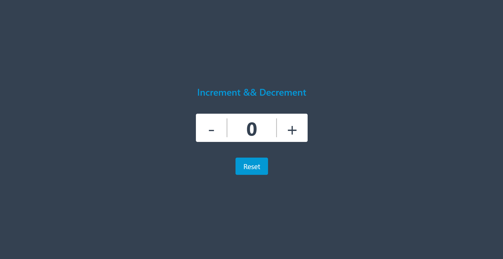

# React Counter App

A simple and responsive Counter Application built with **React** to practice **state management** using the **useState Hook**.


## 📸 Preview



---

## ✨ Features

- ➕ Increment Counter
- ➖ Decrement Counter
- 🔄 Reset Counter
- 🔢 Supports Negative Values


---

## 🛠️ Tech Stack

- React
- JavaScript (ES6+)
- Tailwind CSS
- Vite

---

## 📚 What I Learned

While building this project, I practiced:

- React Functional Components
- useState Hook
- State Management
- Event Handling
- Component-based Architecture
- Tailwind CSS Styling

---

## 📂 Project Structure

```text
react-counter-app/
│
├── public/
├── screenshots/
│   └── counter-app.png
├── src/
│   ├── App.jsx
│   ├── main.jsx
│   └── ...
├── package.json
├── vite.config.js
└── README.md
```

---

## 🚀 Getting Started

Clone the repository

```bash
git clone https://github.com/Arsh173/react-counter-app.git
```

Go to the project directory

```bash
cd react-counter-app
```

Install dependencies

```bash
npm install
```

Start the development server

```bash
npm run dev
```

---

## 🎯 Future Improvements

- Add Maximum & Minimum Counter Limit
- Add Custom Step Increment/Decrement
- Add Dark/Light Theme
- Add Smooth Animations
- Store Counter Value using Local Storage

---

## 👨‍💻 Author

**Arsh**

- GitHub: [@Arsh173](https://github.com/Arsh173)

---

⭐ If you found thi s project helpful, don't forget to star the repository.